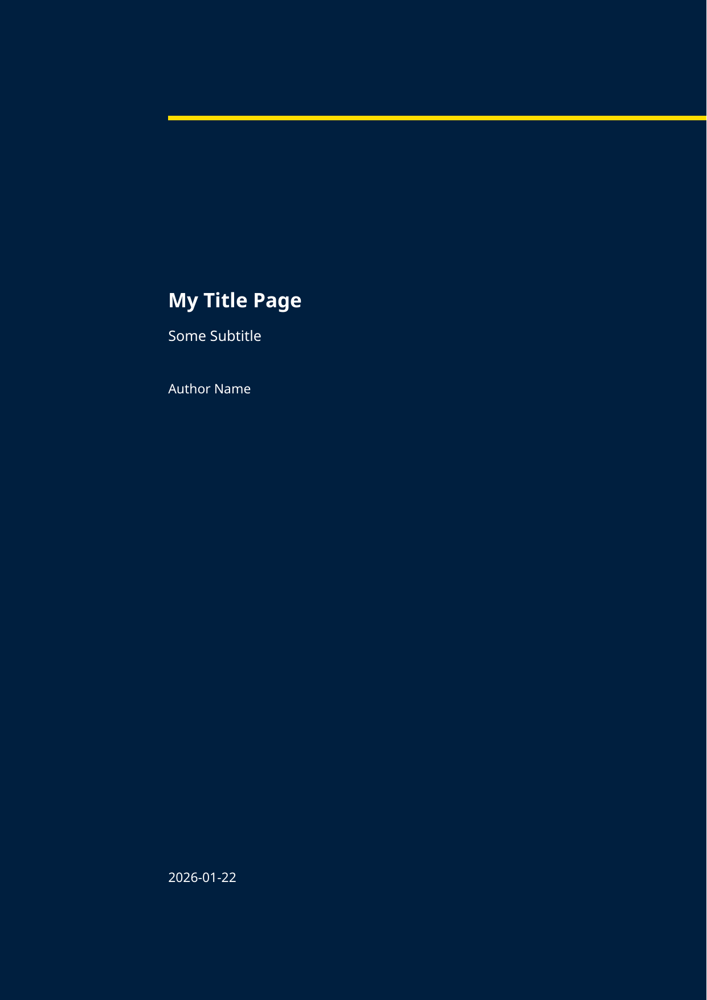
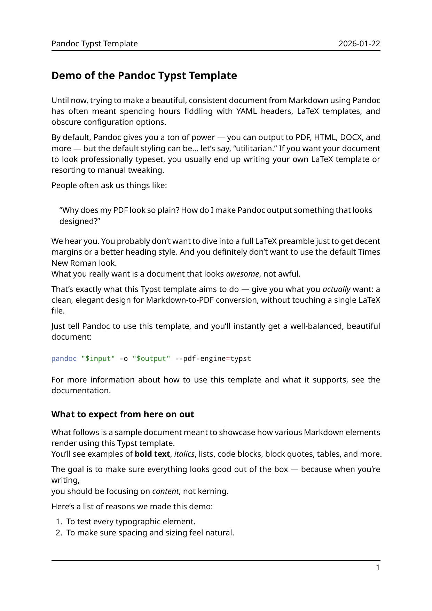
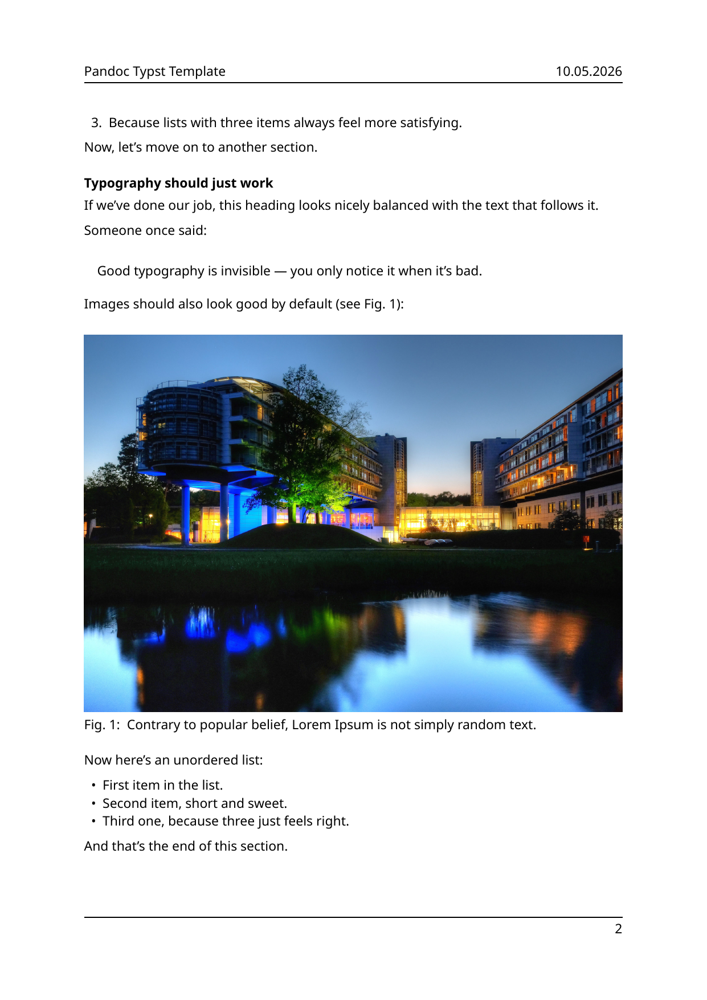
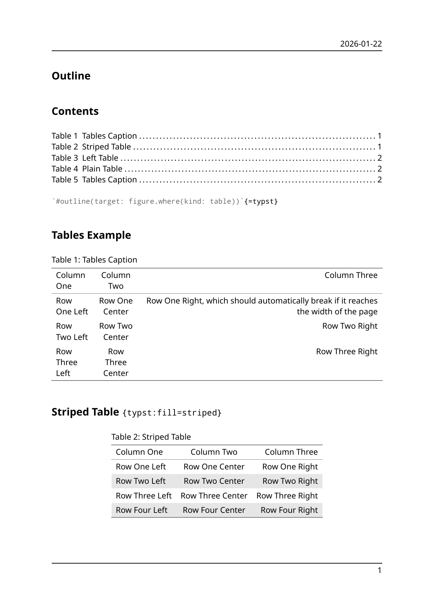
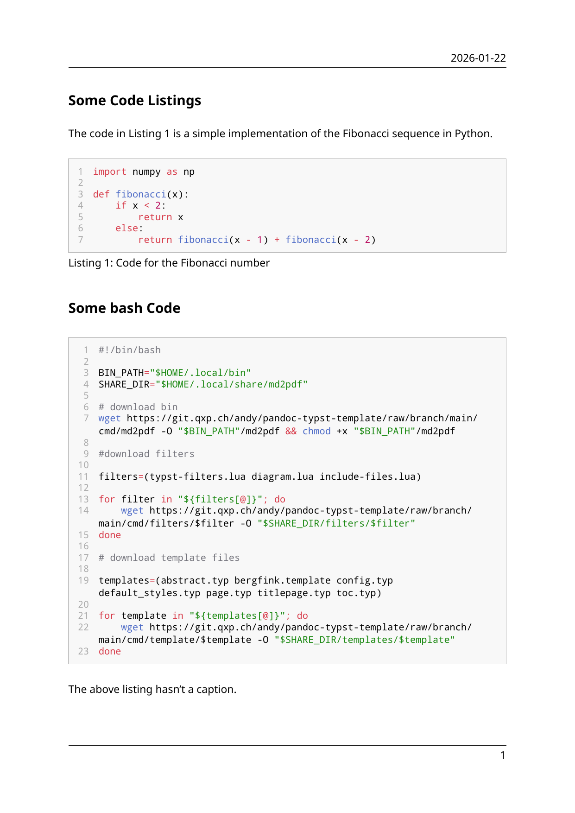
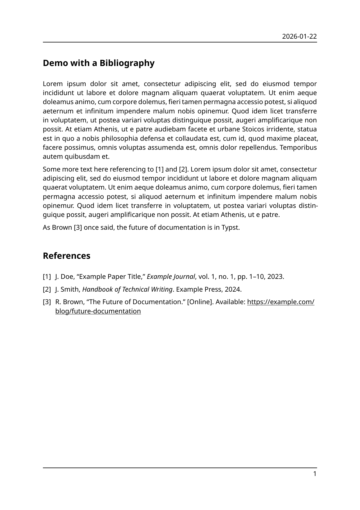
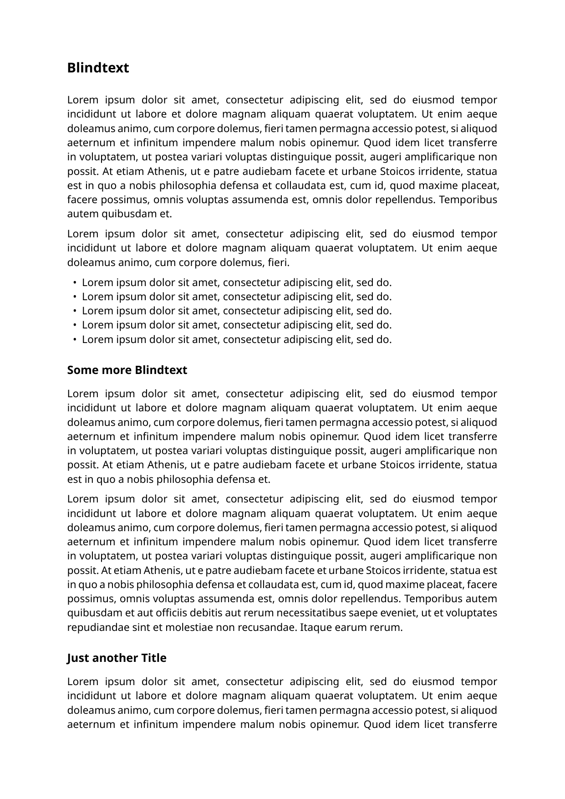
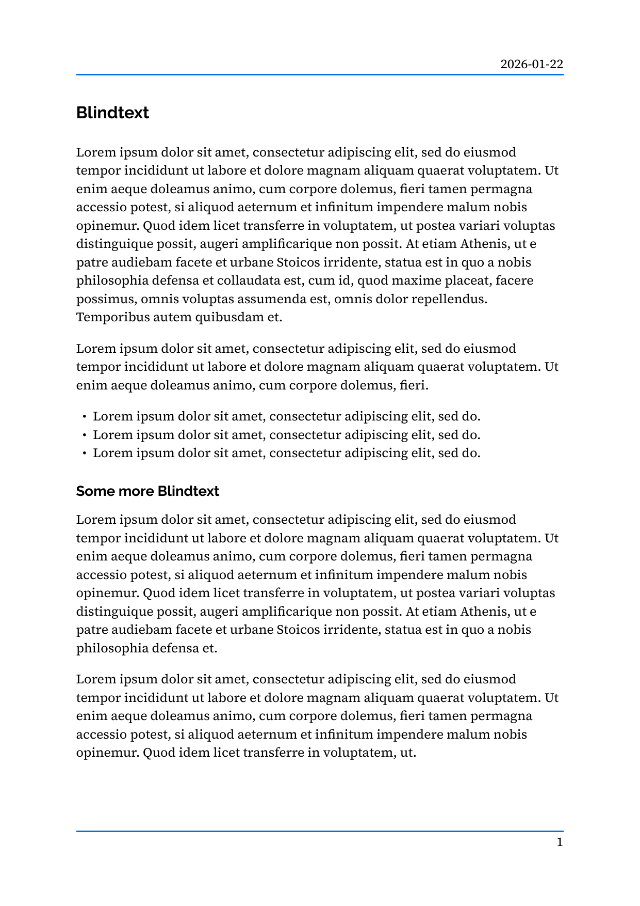
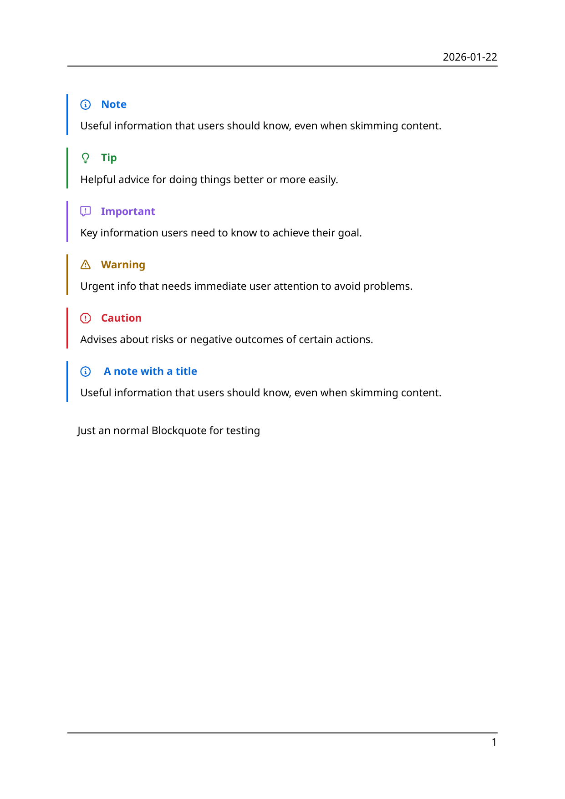
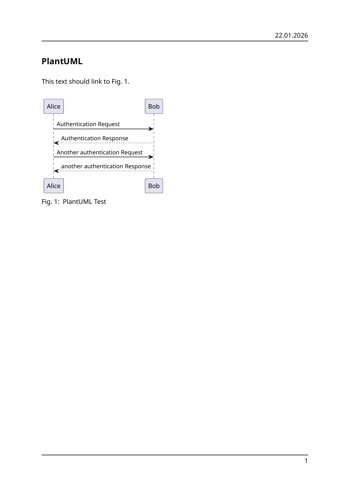

# Bergfink

A Pandoc template for generating PDFs with [Typst](https://typst.app/), plus Lua filters and a small build helper. Based on the [Eisvogel template](https://github.com/Wandmalfarbe/pandoc-latex-template).

## Preview

| Custom title page                               | Basic example page                                  |
| ----------------------------------------------- | --------------------------------------------------- |
|  |  |

## Requirements

- [Pandoc](https://pandoc.org/) 3.0 or newer
- [Typst](https://typst.app/) (used as `--pdf-engine`)
- Optional, for diagrams: [Mermaid CLI](https://github.com/mermaid-js/mermaid-cli) (`mmdc`) and [PlantUML](https://plantuml.com/) (`plantuml`)
- Optional, for `make preview`: `pdftoppm` (poppler-utils)

## Quick start

Clone the repository and run the helper from the repo root:

```bash
./md2pdf.sh examples/basic-example/document.md
```

This writes `examples/basic-example/document.pdf` next to the Markdown source.

To emit Typst instead of PDF:

```bash
./md2pdf.sh examples/basic-example/document.md --typ
```

`md2pdf.py` provides the same interface if you prefer Python.

## Project layout

| Path                      | Purpose                                                                                          |
| :------------------------ | :----------------------------------------------------------------------------------------------- |
| `template/`               | Typst template (`bergfink.typst`), config (`user_cfg.typ`), YAML table helpers (`yamltable.typ`) |
| `filters/`                | Lua filters applied by `md2pdf.sh`                                                               |
| `md2pdf.sh` / `md2pdf.py` | Wrapper around Pandoc with the right template and filters                                        |
| `examples/`               | Sample documents; run `make pdf` to build them all                                               |

## Configuration

Put your customizations in **`template/user_cfg.typ`**. Define a `#let user_cfg = (...)` dictionary with only the keys you want to change; they are merged on top of the template defaults. Do not edit `template/base_cfg.typ` — it is maintained with the template and may change between versions.

Settings are merged in this order (later wins):

1. Template defaults (from `base_cfg.typ`, applied automatically).
2. **`template/user_cfg.typ`** — project-wide overrides when no custom config is passed.
3. **Custom config file** — another Typst file with `#let user_cfg = (...)` (see `examples/custom-config/customcfg.typ`).
4. **YAML front matter** — Pandoc metadata variables mapped in `template/bergfink.typst`.

Pass a custom config with the helper:

```bash
./md2pdf.sh document.md -c path/to/customcfg.typ
```

Or in front matter (path relative to the Markdown file):

```yaml
user-config: customcfg.typ
```

Avoid characters that Pandoc escapes in filenames (for example `\` or `_` in the path string).

## Usage

### `md2pdf.sh`

```text
./md2pdf.sh <input.md> [more.md ...] [options]

  -o, --output <file>     Output PDF (default: first input with .pdf)
  -m, --metadata <file>   Pandoc metadata YAML
  --typ [<file>]          Output Typst instead of PDF
  -c, --config <file>     Typst user config (sets Pandoc variable user-config)
  -w, --watch             Rebuild when inputs change
```

Example with metadata (multi-file thesis):

```bash
./md2pdf.sh examples/phd-example/*.md \
  -o examples/phd-example/document.pdf \
  -m examples/phd-example/metadata.yaml
```

### Raw Pandoc

Equivalent to what the helper runs (paths adjusted to your checkout):

```bash
pandoc input.md -o output.pdf \
  --from markdown \
  --pdf-engine typst \
  --template template/bergfink.typst \
  --lua-filter filters/preserve-ref.lua \
  --lua-filter filters/citations.lua \
  --lua-filter filters/pagebreak.lua \
  --lua-filter filters/caption-code-blocks.lua \
  --lua-filter filters/plantuml.lua \
  --lua-filter filters/mermaid.lua \
  --lua-filter filters/align-figures.lua \
  --lua-filter filters/align-tables.lua \
  --lua-filter filters/callouts.lua
```

Run Pandoc from the directory that contains the Markdown file so relative paths (images, YAML tables, custom config) resolve correctly.

## Lua filters

The helper enables these filters (Typst output only unless noted):

| Filter                    | Role                                                                        |
| :------------------------ | :-------------------------------------------------------------------------- |
| `include-files.lua`       | Include other Markdown files                                                |
| `preserve-ref.lua`        | Keeps trailing HTML-style Typst labels (`<label>`) at the end of paragraphs |
| `citations.lua`           | Typst-style `@ref` / `[@ref]` handling                                      |
| `pagebreak.lua`           | LaTeX-style page breaks from `\newpage` and `\pagebreak` to `#pagebreak()`  |
| `caption-code-blocks.lua` | `caption` attribute on fenced code → Typst figure                           |
| `plantuml.lua`            | PlantUML code blocks → SVG (needs `plantuml` in `PATH`)                     |
| `mermaid.lua`             | Mermaid code blocks → SVG (needs `mmdc` in `PATH`)                          |
| `newline.lua`             | HTML `<br>` to Typst `LineBreak`                                            |
| `align-figures.lua`       | `align` on images and diagram blocks                                        |
| `align-tables.lua`        | `align` on tables                                                           |
| `callouts.lua`            | GitHub-style alerts (`> [!NOTE]`, etc.)                                     |

To include other Markdown files using the `include-files.lua` filter, use:

````md
```{.include shift-heading-level-by=0}
another-file.md
```
````

## YAML-driven tables

`template/yamltable.typ` provides `#yaml-table("path/to/data.yaml")` and `#yaml-table-figure(...)` for tables defined in YAML (key–value, map, grid, matrix, and record layouts). Embed Typst in Markdown with `{=typst}` blocks or use the helper on `examples/yaml-table/document.md`. See that example and `template/yamltable.typ` for schemas and options.

## More images

| Image                                          | Tables                                   |
| ---------------------------------------------- | ---------------------------------------- |
|  |  |

| Code listing                                          | Bibliography                                         |
| ----------------------------------------------------- | ---------------------------------------------------- |
|  |  |

| No header and footers                                             | No text justify and custom header and footer strokes  |
| ----------------------------------------------------------------- | ----------------------------------------------------- |
|  |  |

| Alerts                                   | Diagrams                                     |
| ---------------------------------------- | -------------------------------------------- |
|  |  |

### Makefile

Use the Makefile to build the examples in this repository.

```bash
make pdf              # all example PDFs
make typ              # all example Typst files
make basic-example    # one example: Typst, PDF, and preview PNGs
make preview          # regenerate preview-*.png under examples/
make phd              # generate the phd example
make all              # generate all above
```
