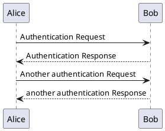

# PlantUML

This text should link to @plantuml-test.



# Mermaid

```{.mermaid caption="Mermaid Test" align=left}
---
title: Simple sample
---
stateDiagram-v2
    [*] --> Still
    Still --> [*]

    Still --> Moving
    Moving --> Still
    Moving --> Crash
    Crash --> [*]

```
